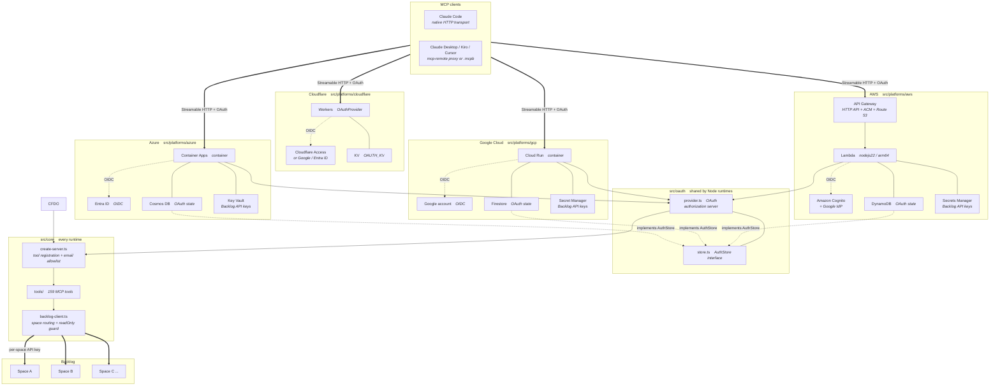
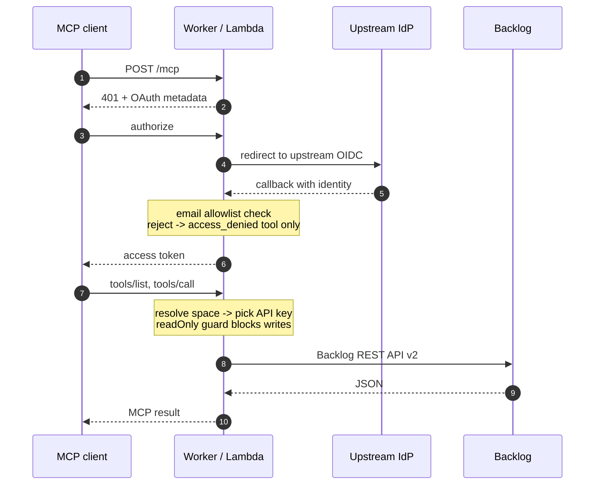

# Backlog Remote MCP Server

A remote MCP (Model Context Protocol) server for Backlog.
**Deployable to Cloudflare Workers, AWS, Google Cloud, or Azure.**

English | [日本語](README_ja.md)

## Features

- **Multi-space** — serve several Backlog spaces from one server
- **Read-only guard** — mark a shared space `readOnly` to reject every write API call
- **Per-user Backlog keys** — each caller acts as themselves in Backlog instead of one shared system user. Clients can also bring their own space, behind a domain allowlist. Clients that can set headers send the key per request; the rest enter it once on the consent screen. **The server stores no Backlog credentials either way** ([details](docs/backlog.md#per-user-api-keys))
- **OAuth 2.1 + PKCE** — supports Dynamic Client Registration (DCR), so MCP clients connect directly
- **Email allowlist** — restrict who can use the server
- **Four deployment targets** — the same business logic runs on Cloudflare, AWS, Google Cloud, or Azure
- **Tools that follow the official API docs** — every endpoint in the [Backlog API v2 docs](https://developer.nulab.com/docs/backlog/) is covered, with matching parameter names, required fields and required roles
- **Try it without deploying** — a smoke test and a stdio server run the same tools on local Node.js, so you can check behavior without any cloud billing ([details](#trying-the-tools-without-deploying-no-oauth))

## Choosing a deployment

| | Cloudflare | AWS | Google Cloud | Azure |
|---|---|---|---|---|
| Runtime | Workers (edge) | Lambda + API Gateway | Cloud Run | Container Apps |
| MCP session | Stateless | Stateless | Stateless | Stateless |
| OAuth authorization server | `@cloudflare/workers-oauth-provider` | `src/oauth` | `src/oauth` | `src/oauth` |
| Upstream IdP | Cloudflare Access | Amazon Cognito | Google account | Microsoft Entra ID |
| State storage | Workers KV | DynamoDB (TTL) | Firestore (TTL) | Cosmos DB (TTL) |
| Secrets | Workers Secrets | Secrets Manager | Secret Manager | Key Vault |
| IaC | wrangler | AWS SAM | Terraform | Bicep |
| Config file | `.dev.vars` | `infra/aws/params.yaml` | `infra/gcp/terraform.tfvars` | `infra/azure/params.json` |

The tools and their behavior are identical on all of them. Every platform can use
either Google or Microsoft Entra ID as its upstream IdP; the table shows the default.

- [Deploying to Cloudflare](docs/deploy-cloudflare.md)
- [Deploying to AWS](docs/deploy-aws.md)
- [Deploying to Google Cloud](docs/deploy-gcp.md)
- [Deploying to Azure](docs/deploy-azure.md)

## Estimated Cost

> **Note**
> **These are reference figures only.** Actual charges vary by region, usage, and
> pricing changes. Use the official calculators for real estimates.
>
> - [Cloudflare Zero Trust pricing](https://www.cloudflare.com/plans/zero-trust-services/)
> - [Cloudflare Workers pricing](https://developers.cloudflare.com/workers/platform/pricing/)
> - [AWS Pricing Calculator](https://calculator.aws/#/addService)
> - [Google Cloud Pricing Calculator](https://cloud.google.com/products/calculator)
> - [Azure Pricing Calculator](https://azure.microsoft.com/pricing/calculator/)

### Assumptions

Personal use or a small team.

| Item | Assumption |
|---|---|
| Users | 1–5 |
| MCP requests | ~3,000 / month |
| Backlog spaces | 3 |
| Log retention | 30 days |
| Region | Tokyo (`ap-northeast-1` / `asia-northeast1` / `japaneast`) |

### Fixed costs (charged even when idle)

| | Cloudflare | AWS | Google Cloud | Azure |
|---|---|---|---|---|
| Runtime | $0 (Free plan works) | $0 | $0 (`min_instances = 0`) | $0 (`minReplicas = 0`) |
| Auth platform | $0 (Zero Trust free up to 50 users) | $0 (within Cognito free tier) | $0 (Google sign-in) | $0 (Entra ID free tier) |
| Secrets | $0 (Workers Secrets are free) | **~$0.80** (2 Secrets Manager secrets) | $0 (3 versions, within free tier) | $0 (Key Vault bills operations, not secrets) |
| Container registry | n/a | n/a | $0 (Artifact Registry, 0.5 GB free) | **~$5** (ACR Basic, $0.1666/day) |
| Certificates | $0 | $0 (public ACM certificates are free) | $0 (managed by Cloud Run) | $0 (managed by Container Apps) |
| **Total** | **$0** | **~$1/month** | **~$0** | **~$5/month** |

Each platform's fixed cost comes from exactly one place:

- **AWS** — Secrets Manager bills per secret per month whether or not it is used.
- **Azure** — the container registry. ACR has no free tier, and Basic is billed per day
  even for a single image. Pointing `image` at a free registry such as GHCR removes this,
  at the cost of managing registry credentials yourself.
- **Cloudflare / Google Cloud** — nothing. Workers Secrets are free, and Google's Secret
  Manager free tier covers the three versions this project stores.

Note that **Key Vault does not charge per secret**, unlike AWS Secrets Manager. It bills
per 10,000 operations, and this server caches secrets after the first read.

### What is metered

| | Cloudflare | AWS | Google Cloud | Azure |
|---|---|---|---|---|
| Requests | Workers | Lambda + API Gateway | Cloud Run | Container Apps |
| State storage | Workers KV | DynamoDB | Firestore | Cosmos DB (serverless) |
| Logs | Workers Logs | CloudWatch Logs | Cloud Logging | Log Analytics |

At the assumed volume (~3,000 requests/month) **all four stay within their free
allowances**. The exception is API Gateway HTTP API, which has no perpetual free tier, so
AWS accrues a small charge proportional to request count (roughly $1 per million
requests).

### Thresholds worth knowing

**Cloudflare — the 50-user line for Zero Trust**

Zero Trust (Access) is **free for up to 50 users**. Beyond that you move to a paid plan
billed **per user per month**. This is the cost that scales with headcount.

**Cloudflare — Workers Free plan limits**

This project runs MCP statelessly, so it needs only Workers and KV — both available
on the Workers Free plan. The Free plan does cap daily requests and other usage, and
exceeding a cap returns errors. For sustained use consider Workers Paid (from $5/month).

**AWS — the Lambda free tier is perpetual**

Lambda includes a perpetual free tier of 1M requests and 400,000 GB-seconds per month.
**API Gateway and Secrets Manager have no perpetual free tier.**

**AWS — CloudWatch Logs**

Logs are billed on ingestion volume. This template manages retention explicitly via
`LogRetentionDays` (default 30), so logs do not accumulate indefinitely.

**Google Cloud / Azure — cold starts are the price of $0 idle**

Both default to scaling to zero, so an idle deployment costs nothing but the first
request after a quiet period pays container startup. Raising `min_instances` /
`minReplicas` to 1 removes that, and is the single change most likely to turn a
near-zero bill into a real one — keeping one small always-on instance costs roughly
$10–20/month on either platform.

**Google Cloud / Azure — no per-user authentication cost**

Signing in with a Google account or with Entra ID does not bill per user for this use.
Unlike Cloudflare's 50-user Zero Trust line, headcount is not the variable that changes
the bill.

### Summary

| Scale | Cloudflare | AWS | Google Cloud | Azure |
|---|---|---|---|---|
| Personal | roughly $0 | ~$1/month | roughly $0 | ~$5/month |
| Tens of users (≤50) | roughly $0–$5 | $1 to a few dollars/month | roughly $0–$2 | ~$5–7/month |
| 51+ users | Zero Trust switches to per-user billing | depends on the Cognito MAU free tier | no per-user cost | no per-user cost |

**For small teams Cloudflare and Google Cloud are the cheapest, with no fixed cost.**
AWS carries the Secrets Manager fixed cost and Azure the registry fixed cost; both are
worth it if you want to consolidate into an existing footprint or govern access through
that cloud's IAM. Above 50 users, Cloudflare is the only one where the bill grows with
headcount.

## Setup

### 0. Prerequisites

Node.js 20 or later.

```bash
git clone <this-repo>
cd backlog-remote-mcp-server
npm install
```

Additional tools depend on the deployment target:

| Target | Requirements |
|---|---|
| Cloudflare Workers | Cloudflare account with Workers enabled, custom domain (optional) |
| AWS | AWS account, AWS CLI v2, AWS SAM CLI |

### Order to follow

1. **[Backlog API keys and space configuration](docs/backlog.md)** — shared by every platform
2. Pick an identity provider
   - **[Google Cloud](docs/idp-google.md)**
   - **[Microsoft Entra ID](docs/idp-entra-id.md)**
3. Pick a deployment target
   - **[Cloudflare Workers](docs/deploy-cloudflare.md)**
   - **[AWS](docs/deploy-aws.md)**

### If something goes wrong

Troubleshooting sections live at the end of each deployment guide.

- [Cloudflare](docs/deploy-cloudflare.md#troubleshooting)
- [AWS](docs/deploy-aws.md#troubleshooting)


## Architecture

The same MCP server runs on four platforms. Each platform subgraph holds its own
wiring — gateway, storage and upstream IdP — and they all funnel into the shared
`src/core`, which is where the tools and the Backlog client live.



### Request flow



Authorization happens in two layers. The upstream IdP decides **who** may sign in,
and the email allowlist decides **who gets tools**: a user outside the allowlist
receives a server exposing only `access_denied`. The `readOnly` flag on a space
rejects every non-GET request in the API client layer, so it cannot be bypassed by
an individual tool.

### Directory layout

Business logic is separated from runtime wiring.

```
src/
  core/                    Every runtime. Depends only on the MCP SDK and zod
    backlog-client.ts      Backlog API client (including the readOnly guard)
    tools/                 159 MCP tools (every endpoint in the official API docs)
    create-server.ts       MCP server assembly and authorization
    credentials.ts         Per-user Backlog keys: parsing and overlay
    credential-envelope.ts Sealing those keys into tokens, so none are stored
  oauth/                   Node runtimes. OAuth authorization server (Express)
    provider.ts            OAuthServerProvider implementation
    store.ts               AuthStore interface — the persistence port
    upstream.ts            Upstream OIDC client
    consent.ts             Consent screen
    app.ts                 Express app exposing /authorize, /token, /mcp, ...
  platforms/
    cloudflare/            Workers wiring (uses its own Workers OAuth provider)
    aws/                   Lambda wiring + DynamoDB / Secrets Manager adapters
    gcp/                   Cloud Run wiring + Firestore / Secret Manager adapters
    azure/                 Container Apps wiring + Cosmos DB / Key Vault adapters
scripts/
  local/                   stdio server and smoke test that run without deploying
infra/
  aws/                     SAM template and parameters
  gcp/                     Terraform configuration
  azure/                   Bicep template and parameters
```

Three layers, by how widely each one can be reused:

- **`src/core`** depends only on `@modelcontextprotocol/sdk` and `zod` and references
  no runtime-specific API. Every platform uses it as-is.
- **`src/oauth`** is the OAuth authorization server. It is Express-based, so it needs
  Node, but it holds no cloud-specific code: persistence goes through the `AuthStore`
  interface and the upstream IdP through a generic OIDC client. Cloudflare does not
  use it — Workers has its own OAuth provider.
- **`src/platforms/<name>`** is the only place a cloud SDK appears.

Adding another Node-hosted platform (Cloud Run, Container Apps, ...) therefore means
implementing `AuthStore` for that platform's database, a secret lookup, and an entry
point that hands the Express app to the runtime. The authorization server, the tools
and the Backlog client are all reused unchanged.
## Connecting from MCP Clients

Connecting authenticates you to *this server*. Acting on Backlog as yourself needs
your own Backlog API key as well, and how you supply it depends on the client:
those that can set HTTP headers send it per request, the rest type it once into the
consent screen. Either way the server keeps no copy. See
[Per-user API keys](docs/backlog.md#per-user-api-keys) for the header names and
per-client configuration.

### Claude Desktop / Kiro / Cursor (via mcp-remote proxy)

```json
{
  "mcpServers": {
    "backlog": {
      "command": "npx",
      "args": [
        "mcp-remote",
        "https://<MCP_HOSTNAME>/mcp",
        "--header",
        "X-Backlog-Api-Key:${BACKLOG_API_KEY}"
      ],
      "env": {
        "BACKLOG_API_KEY": "your-own-backlog-api-key"
      }
    }
  }
}
```

On first connection, a browser window opens for authentication.

`--header` is what makes Backlog record the work as you rather than as a shared
system user. Write it with **no space around the `:`** and put the value in `env`
— some clients mishandle spaces inside an argument. Drop the header and the `env`
block if the space you are using has a shared `apiKey` configured on the server.

Serving several Backlog spaces? Swap in the plural header and list one `SPACE=key`
pair per space, separated by commas:

```json
{
  "mcpServers": {
    "backlog": {
      "command": "npx",
      "args": [
        "mcp-remote",
        "https://<MCP_HOSTNAME>/mcp",
        "--header",
        "X-Backlog-Api-Keys:${BACKLOG_API_KEYS}"
      ],
      "env": {
        "BACKLOG_API_KEYS": "WORK=key-for-work,SHARED=key-for-shared"
      }
    }
  }
}
```

The space names are the `name` values from `BACKLOG_SPACES_CONFIG`, matched
case-insensitively. Name a space that is not configured and the request is rejected
rather than quietly falling back to a shared key. List only the spaces you have a key
for; the rest keep whatever the server is configured with. `list_spaces` shows which
spaces ended up with a usable key. See
[Per-user API keys](docs/backlog.md#per-user-api-keys) for both header formats.

Writing the key literally into `args` would leave it in the process list, readable
by anyone else on the machine. The `env` form above avoids that — mcp-remote does
the `${BACKLOG_API_KEY}` substitution itself, so only the placeholder ever appears
in the arguments. A header file works too, and keeps the key out of the
environment as well:

```json
      "args": [
        "mcp-remote",
        "https://<MCP_HOSTNAME>/mcp",
        "--header-file",
        "/path/to/headers.txt"
      ]
```

```
X-Backlog-Api-Key: your-own-backlog-api-key
```

### Claude Desktop (.mcpb bundle)

Instead of hand-editing the JSON above, you can double-click a `.mcpb`
(MCP Bundle) to install it. It is generated during deploy and written to `dist/`.

```bash
npm run mcpb:pack           # generate on its own
npm run aws:deploy          # generated as part of the deploy (Cloudflare: npm run cloudflare:deploy)
```

The bundle takes no API key: its arguments are fixed, so there is nowhere to put a
header. Bundle users supply their key on the consent screen that appears during
authorization instead — see [Per-user API keys](docs/backlog.md#per-user-api-keys).

The endpoint URL is a `user_config` field, and **the domain you deployed to is
baked in as its default**. If you fork this and deploy to your own environment,
your deployment becomes the default. It can still be changed at install time.

Host name resolution order:

1. the `--host` argument
2. the `MCP_HOSTNAME` environment variable (shared with the Cloudflare deploy)
3. `ApiDomainName` in `infra/aws/params.yaml` (AWS deploy)
4. `MCP_HOSTNAME` in `.dev.vars`

**The bundle does not contain the server itself.** MCPB is a local-execution
format: a manifest's `server.type` can only be `node`, `python`, `binary` or
`uv`, and there is no type that points at a remote MCP server. The bundle ships
`mcp-remote` as a local stdio proxy that connects to your deployed server.
`mcp-remote` is vendored into the bundle so nothing is fetched over the network
at runtime.

Claude Code does not use this bundle — it stays on `claude mcp add --transport http`.

### MCP Inspector (for testing)

```bash
npx @modelcontextprotocol/inspector@latest
```

Enter `https://<MCP_HOSTNAME>/mcp` in the inspector and complete the OAuth flow via OAuth Settings.

To try the tools without deploying, run `npx @modelcontextprotocol/inspector npm run -s local:stdio` to connect to a local stdio server ([details](#trying-the-tools-without-deploying-no-oauth)).

## Usage

### Specifying a Space

All tools accept an optional `space` parameter:

```
# Use default space
"Show me the issues for PROJECT-KEY"

# Specify a particular space
"List projects in the PERSONAL space"
→ space: "PERSONAL"
```

### Examples

```
# List configured spaces
"What Backlog spaces are available?" → list_spaces

# List projects
"Show COMPANY_A projects" → get_project_list(space: "COMPANY_A")

# Create an issue
"Create a new bug issue in PROJECT-KEY" → add_issue(...)

# List pull requests
"Show open PRs in repo-name" → get_pull_requests(...)
```

## Available Tools

| Category | Tools |
|----------|-------|
| Space | list_spaces, get_space, get_users, get_myself, get_space_activities, get_activity, get_space_icon, get_space_notification, update_space_notification, get_space_disk_usage, get_licence, get_rate_limit |
| User | get_user, add_user, update_user, delete_user, get_user_icon, get_user_activities, get_user_stars, get_user_stars_count, get_recently_viewed_issues, add_recently_viewed_issue, get_recently_viewed_projects, get_recently_viewed_wikis, add_recently_viewed_wiki |
| Team | get_teams, get_team, add_team, update_team, delete_team, get_team_icon, get_project_teams, add_project_team, delete_project_team |
| Project | get_project_list, get_project, add_project, update_project, delete_project, get_project_users, get_project_icon, get_project_activities, add_project_user, delete_project_user, get_project_administrators, add_project_administrator, delete_project_administrator |
| Status | get_project_statuses, add_project_status, update_project_status, delete_project_status, update_project_status_order |
| Issue | get_issue, get_issues, count_issues, add_issue, update_issue, delete_issue, get_issue_comments, add_issue_comment, get_priorities, get_issue_types, get_categories, get_version_milestones, add_version_milestone, get_resolutions, count_issue_comments, get_issue_comment, update_issue_comment, delete_issue_comment, get_issue_comment_notifications, add_issue_comment_notification, get_issue_participants, get_issue_shared_files, link_issue_shared_files, unlink_issue_shared_file, get_related_issues, add_related_issue, remove_related_issue |
| Issue settings | add_issue_type, update_issue_type, delete_issue_type, add_category, update_category, delete_category, update_version_milestone, delete_version_milestone |
| Custom field | get_custom_fields, add_custom_field, update_custom_field, delete_custom_field, add_custom_field_item, update_custom_field_item, delete_custom_field_item |
| File / Attachment | get_shared_files, get_shared_file, get_project_disk_usage, post_attachment, get_issue_attachments, get_issue_attachment, delete_issue_attachment |
| Document | get_documents_count, get_documents, get_document_tree, get_document, add_document, delete_document, get_document_attachment, get_document_comments, add_document_tags, remove_document_tags |
| Wiki | get_wiki_pages, get_wikis_count, get_wiki, add_wiki, update_wiki, delete_wiki, get_wiki_tags, get_wiki_history, get_wiki_stars, get_wiki_attachments, add_wiki_attachments, get_wiki_attachment, delete_wiki_attachment, get_wiki_shared_files, link_wiki_shared_files, unlink_wiki_shared_file |
| Git / Pull request | get_git_repositories, get_git_repository, get_pull_requests, get_pull_request, add_pull_request, update_pull_request, get_pull_request_comments, add_pull_request_comment, count_pull_requests, count_pull_request_comments, update_pull_request_comment, get_pull_request_attachments, get_pull_request_attachment, delete_pull_request_attachment |
| Notification | get_notifications, get_notifications_count, reset_unread_notification_count, mark_notification_as_read |
| Watching | get_watchings, get_watchings_count, get_watching, add_watching, update_watching, delete_watching, mark_watching_as_read |
| Star | add_star, delete_star |
| Webhook | get_webhooks, get_webhook, add_webhook, update_webhook, delete_webhook |

`add_*`, `update_*`, and `delete_*` are write operations. Calling them against a space configured with `readOnly: true` is rejected before any request reaches the Backlog API. Use `list_spaces` to see the `readOnly` status of each space.

Tool parameters follow the [official Backlog API v2 docs](https://developer.nulab.com/docs/backlog/). Tools that need admin or other roles say so in their descriptions.

- **Not in the official docs**: `add_user` / `update_user` / `delete_user`, `add_team` / `update_team` / `delete_team`, and `statusId` on `update_pull_request` are absent from the current docs. They are kept for existing users, and their descriptions say so.
- **Wiki**: since 2026-07-14, new spaces cannot use Wiki and new projects have it disabled by default. Use the Document tools for new work.
- **Document**: Backlog has no Document update API yet, so only create, read, delete and tag add/remove are supported.

## Security

- **Authentication**: Cloudflare Access → Google / Microsoft Entra ID. The entire OAuth flow is managed by Cloudflare
- **Authorization**: `ALLOWED_EMAILS` provides an application-level email allowlist.
  **Leaving it empty disables the allowlist**, so anyone who can sign in through the
  upstream IdP gets every tool
- **Double-check**: Access Policy (Cloudflare side) + in-app allowlist (Worker side)
- **API Key Protection**: Backlog API keys are stored in Cloudflare Secrets and never exposed to clients
- **PKCE + CSRF**: OAuth flow is protected with PKCE (S256) and CSRF tokens
- **Client consent**: Dynamic Client Registration is open to anyone, so authorization is gated behind a consent screen that names the client and its redirect target and requires a CSRF-protected approval. Approvals are keyed on `client_id` + `redirect_uri`, so re-registering with a different redirect target cannot inherit a prior approval
- **Write guard**: Spaces marked `readOnly: true` reject every non-GET call. The check lives in the API-call layer of `src/core/backlog-client.ts`, so it does not depend on individual tool implementations
- **Configuration isolation**: All environment-specific values live in `.dev.vars` (untracked). The repository contains placeholders only
- **Dependency cooldown**: `.npmrc` sets `min-release-age=3`, so dependency resolution only considers package versions that have been public for at least three days. Malicious npm releases are typically published and taken down within a couple of days, and this avoids that window

### Supply chain

`.npmrc` pins a cooldown on dependency resolution:

```ini
min-release-age=3
```

npm will only pick versions that have been available for at least three days. The
attack pattern this targets is a malicious version published (often over a weekend)
and taken down a few days later — a cooldown means you never resolve to it.

Two limits are worth knowing:

- **It applies to resolution, not to `npm ci`.** `npm ci` installs exactly what
  `package-lock.json` says. The cooldown protects the moment a version *enters* the
  lockfile, which is where it matters; a compromised version already committed to the
  lockfile is not caught by this.
- **Three days is a floor, not a guarantee.** Campaigns that survive longer than the
  window still get through. Raise the number if you want more margin; the cost is
  lagging behind upstream fixes by that many days.

Install scripts are the usual execution vector for these packages. npm 11 blocks them
by default and lists what it skipped, so review that output rather than reflexively
running `npm approve-scripts --all`.

### Operational notes

- `ALLOWED_EMAILS` is the effective authorization boundary for this server. There is no zone-level Access application in front of the Worker
- `npm run cloudflare:deploy` **overwrites** production secrets with the values in `.dev.vars`. If you need different values locally and in production, use `cloudflare:deploy:no-secrets` for routine deploys and push secrets explicitly with `cloudflare:secrets:push`
- A Backlog API key carries the full permissions of its owner. For spaces that need no writes, issue a read-only key *and* set `readOnly: true`

## Local Development

Local runs use the Cloudflare Workers build (`wrangler dev`). Because the business logic
lives in `src/core`, whatever you verify here holds for the AWS deployment too.

```bash
cp .dev.vars.example .dev.vars   # fill in your values
npm run dev
# Server starts at http://localhost:8788/mcp
```

`wrangler dev` emulates KV locally, so it never touches real Cloudflare resources.

### Trying the tools without deploying (no OAuth)

To check tool behavior only, you can run the same tool set as production
(`src/core/create-server.ts`) on local Node.js, skipping OAuth, Cloudflare Access and `wrangler`.
No cloud resources are used, so nothing is billed; the only outbound traffic goes to the Backlog API.

Provide the config in one of these ways (highest priority first). Never commit API keys.

- `BACKLOG_SPACES_CONFIG` env var (same JSON as production)
- `BACKLOG_DOMAIN` and `BACKLOG_API_KEY` env vars (single space; `BACKLOG_READ_ONLY=true` for read-only)
- `BACKLOG_SPACES_CONFIG` in `.dev.vars`

**Smoke test**: calls the main tools against a real space and prints OK / NG / WARN / SKIP.

```bash
export BACKLOG_DOMAIN=your-space.backlog.com BACKLOG_API_KEY=xxxx
npm run smoke -- --project TEST            # read-only
npm run smoke -- --project TEST --write    # also creates and deletes documents, issues and issue links
```

Run `--write` against a test project. Everything it creates is deleted at the end (`--keep` keeps it).
Many deletes require admin rights; without them you get WARN and should delete the items in the UI.
Add `--verbose` to print each tool response.

**stdio server**: starts the same tools as a stdio MCP server so you can call them one by one
from Claude Code or MCP Inspector.

```bash
claude mcp add backlog-local -e BACKLOG_DOMAIN=your-space.backlog.com -e BACKLOG_API_KEY=xxxx \
  -- npm --prefix "$PWD" run -s local:stdio
npx @modelcontextprotocol/inspector npm run -s local:stdio
```

### Verifying the setup

Run the full OAuth-to-tool-call check in one command:

```bash
npm run check:local
```

It performs the following, opening a browser partway through so you can log in:

1. Fetch the Authorization Server metadata
2. Dynamic client registration
3. Approve in the browser → IdP login
4. Token exchange with PKCE
5. `initialize` / `tools/list`
6. Call `get_space` and show the real response from Backlog

If `tools/list` returns only `access_denied`, the email you logged in with is not in the
allowlist.

**It also works against a deployed endpoint:**

```bash
npm run check:local -- --base https://your-deployed-host
```

### Running over HTTPS

Use this when the IdP will not accept an `http://` redirect URL.

```bash
npm run dev:https
# Server starts at https://localhost:8788/mcp (self-signed certificate)
```

### Type checking and tests

Types are split per platform, so misusing a Workers global in AWS code (or vice versa)
is a type error.

```bash
npm run type-check   # one pass per platform tsconfig (cloudflare / aws / gcp / azure)
npm test             # runs all suites below
```

| Command | Covers |
|---|---|
| `npm run test:oauth` | OAuth authorization server logic (DCR, PKCE, single-use tokens, scopes, revocation) |
| `npm run test:oauth-consent` | Consent screen (HTML escaping, signed cookies, CSRF, approval gate) |
| `npm run test:oauth-upstream` | Upstream OIDC client (PKCE pair, token exchange, ID token verification) |
| `npm run test:aws-store` | DynamoDB store client-registration TTL and renewal |
| `npm run test:credentials` | Per-user key headers: parsing, overlay, and refusal to fall back on a typo |
| `npm run test:user-keys` | End to end: the caller's key reaching the outgoing Backlog request |
| `npm run test:envelope` | The sealed envelope, and that no Backlog key is ever written to the store |
| `npm run test:client-spaces` | Client-declared spaces, and that the domain allowlist stops SSRF attempts |

None of them reach external services — DynamoDB, Backlog and the upstream IdP are stubbed.
To check that the tools work against a real Backlog space, use the [smoke test](#trying-the-tools-without-deploying-no-oauth) (`npm run smoke`).

### Configuration files

| File | Purpose | Git |
|---|---|---|
| `.dev.vars` | Local development + Cloudflare deploy | ignored |
| `.dev.vars.example` | Template for the above | committed |
| `infra/aws/params.yaml` | AWS deploy | ignored |
| `infra/aws/params.example.yaml` | Template for the above | committed |

See the deployment guides for how to fill them in.

## License

MIT
